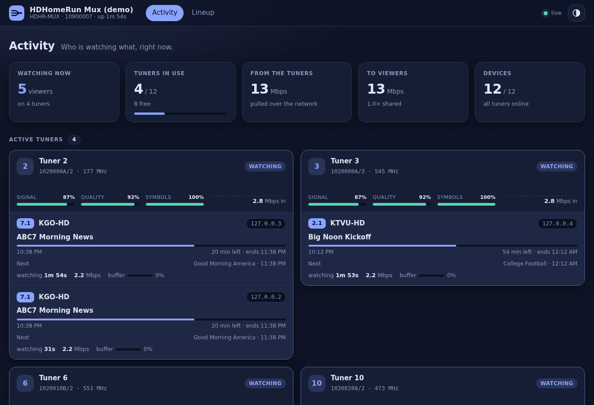
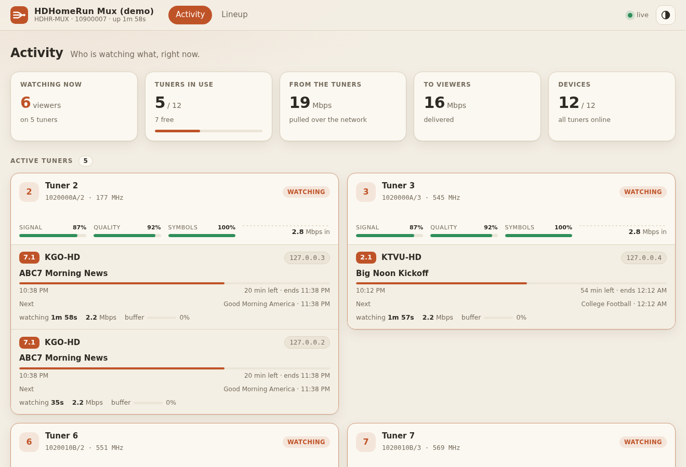
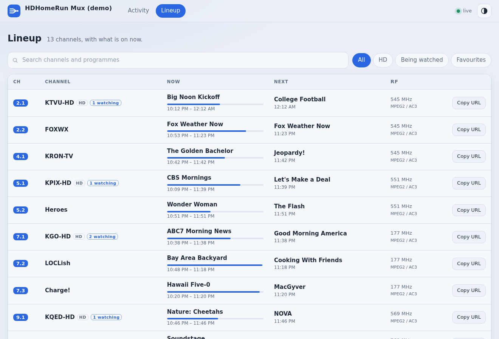

# hdhr-mux-demux

A virtual HDHomeRun that **combines several physical HDHomeRun devices into
one** (4 devices × 4 tuners = one 16-tuner device) and **shares a physical
tuner between every client watching the same RF channel**.

```
 Channels DVR / Plex / Jellyfin / hdhomerun_config / VLC ...
      |  discovery (UDP 65001)  control (TCP 65001)  web/API (80)  streams (5004)
      v
 +-----------------------------------------------------------+
 |  virtual HDHomeRun: tuners 0..15, one lineup              |
 |   each viewer has its own PID / program filter + buffer   |
 |   +----------------+  +----------------+                  |
 |   | shared stream  |  | shared stream  |   ...            |
 |   | RF 207 MHz     |  | RF 569 MHz     |                  |
 |   +-------+--------+  +-------+--------+                  |
 |   tuner pool: classes, failover, lingering, eviction      |
 +-----------|-------------------|---------------------------+
        HTTP GET :5004/tunerN/chFREQ  (pulled from the devices)
```

## How a request flows

`GET http://MUX:5004/auto/v2.4`

1. The lineup (built by the scan) says 2.4 is program 6 on 545 MHz, ATSC 1.0.
2. `/auto/` first looks for a tuner an earlier `/auto/` request opened on the **same RF channel**
   (or ATSC 3.0 service) and joins it with its own program filter; only otherwise does it open a
   free tuner. `/tunerN/...` asks for that exact tuner and gets it, or `804 Tuner In Use` if it is busy,
   even with the same channel (as on a real device). `805 All Tuners In Use` if nothing can serve
   an `/auto/` request.
3. If no tuner carries 545 MHz yet, the best free one is chosen and opened with
   `GET http://DEVICE:5004/tunerM/ch545000000` (the whole multiplex).
4. The viewer's filter keeps PAT (rewritten to just program 6), PMT, PCR and
   the elementary streams; everything else is dropped.
5. Once the multiplex's tables are known, the device is told (through the tuner's PID
   filter) to send only what is needed: see *Bandwidth* below.
6. Data goes to the client from a per-client buffer (16 MiB by default); a slow
   client loses data, never holds the others up.
7. When the last viewer leaves, the tuner is released (after `linger`).

### Bandwidth

A tuner delivers its whole multiplex, about 19 Mbit/s, however few programs are watched.
After the HTTP request has started, the mux takes the tuner's lock over (`lockkey force`, then
a lock key of its own; the stream keeps flowing, checked on real devices) and sets the tuner's
`filter` to the PAT, the PMTs, the PSIP guide tables and the audio, video and PCR PIDs of
programs somebody watches. With one HD program on a multiplex that is roughly 6-9 Mbit/s
over the LAN instead of 19; a lingering stream nobody watches drops to the tables alone.

* Until the PAT is known (a few seconds) and whenever a viewer wants the whole multiplex
  (`hdhomerun_config save` without a program, a raw PID filter covering everything), the
  filter stays open.
* A new viewer's PIDs are added at once; PIDs nobody needs any more are dropped after 5 s, so
  flipping back and forth does not make the filter flap.
* Guide collection is unaffected: the PSIP PIDs always stay in the filter, so the programmes of
  unwatched channels keep arriving.
* When the stream ends the mux puts the filter back to everything and releases the lock; a
  lock left behind by a crash expires on the device by itself (under a minute, measured).
* Not applied to ATSC 3.0 (the device already sends one service) and to `guide.unlocked`
  passes (whoever takes such a tuner over would inherit the filter). A device that refuses the
  lock swap is left unmasked. `upstream.mask: false` switches the feature off.

## Tuner numbering and allocation

* Tuners are numbered `0..N-1` across devices in a stable order (device ID
  order the first time, then remembered in `<state_dir>/devices.json`, so a
  device being offline or added later never renumbers the others). Device 0's
  tuners are 0-3, device 1's are 4-7, and so on.
* **Strict 1:1.** Virtual tuner *N* is physical tuner *N*: whatever it streams
  comes from that tuner, and status queries for it (control protocol or
  `status.json`) describe it. Several `/auto/` viewers of the same RF channel share one
  virtual tuner (each with its own program filter); that is how tuners are saved.
* **Direct requests are trusted.** A client that asks for a tuner by number (HTTP `/tunerN/`, or the
  control protocol: tvheadend, `hdhomerun_config`, which lock it and may receive over UDP/RTP) gets
  that tuner and keeps it, as on a real HomeRun; nobody else is attached to it. A direct client
  never joins anybody: it is refused (`804`, or "resource locked") when its tuner is busy.
  `/auto/` requests (Channels DVR, the playlist, DLNA) join each other, and with
  **`auto_join_direct`** (default `true`) they also join a tuner a direct client already holds on
  the same RF channel instead of taking another one. The viewer gets its own programme whatever
  the direct client's PID filter does, and keeps the tuner if that client lets go of it (then it is
  released with the last viewer). While `/auto/` viewers are on it the direct client cannot retune
  it (it is told the resource is locked), as on a real device. Set it to `false` to keep direct
  clients' tuners strictly to themselves.
* **`/auto/` maximises free tuners.** It first reuses a tuner that already carries
  the channel (busy, or still lingering on it); only if there is none does it open
  a new one, choosing the one that hurts future requests least:
  * ATSC 1.0 goes to tuners that **cannot** do ATSC 3.0 first (tuners 2 and 3 on
    a 4K device); the 3.0-capable ones are the last resort.
  * ATSC 3.0 goes only to capable tuners (0 and 1 on a 4K device, learned from
    the devices' own `806 Tune Failed` answers).
  * Tuners used by other applications (a DVR sharing the devices) or holding a
    lingering stream come last. A tuner another application is using is never
    taken: `/tunerN/` for it answers `804` and its status shows what the other
    application is doing.
* `/tunerN/` asks for exactly that tuner: it gets it or `804 Tuner In Use`.
* With `linger` (default 5 s) a tuner stays tuned after its last viewer leaves
  so flipping back is instant, but it is **given up immediately** when anyone
  needs a tuner, so channel flipping never runs out.
* If a physical tuner stops delivering (connection drops, stalls, is cleared,
  or the device disappears) its stream is re-opened on the same tuner, and only
  if that fails moved to another one, without viewers reconnecting.

### ATSC 3.0

ATSC 3.0 tuners do not deliver the whole multiplex: the device only streams
the one service you select (`/tunerN/chFREQ-SERVICE`), re-muxed into its own
small transport stream. This was checked on real hardware with both HTTP and
the control protocol (no whole-multiplex stream, no list of services). So on
3.0 channels **each service needs its own physical tuner** (identical requests
still share one) and the multiplexer does no demuxing there.

## What is emulated

| Area | Support |
|---|---|
| UDP discovery on 65001 (wildcard + specific device ID) | yes |
| TCP (and UDP) get/set control protocol, `help` | yes |
| `/tunerN/` `channel` `channelmap` `filter` `program` `target` `status` `streaminfo` `lockkey` `vchannel` `debug` | yes |
| `/sys/model` `hwmodel` `version` `features` `copyright`, `/lineup/location`, `/ir/target` | yes (static values) |
| `target` as `udp://` or `rtp://` (7 TS packets per datagram, as libhdhomerun requires) | yes |
| Lockkeys (`lockkey`, `force`, `lock no longer held`) | yes |
| Port 80: `discover.json`, `lineup.json`, `lineup.xml`, `lineup_status.json`, `lineup.post?scan=…`, `status.json`, `device.xml`, `tuners.html` (every tuner with its channels, clients and their IPs), `lineup.html` | yes |
| M3U/M3U8 playlist of the lineup on `/playlist.m3u8` (also `/playlist.m3u`, `/lineup.m3u`, `/lineup.m3u8`), for players that cannot use `lineup.json` or the HDHomeRun protocol | yes (extension, see below) |
| Port 5004: `/auto/vX.Y`, `/tunerN/vX.Y`, `/auto/chFREQ[-PROGRAM]`, `?duration=`, real error headers (`801`, `804`–`807`) | yes |
| DLNA/UPnP media server on `/dms` (SSDP announcements and search answers, `device.xml`, ContentDirectory with the `Favorites` and `Channels` containers, ConnectionManager), so TVs list the multiplexer as a video source and play its channels | yes (default interface only) |
| Programme guide from the broadcasts (PSIP), XMLTV on `/epg`, JSON on `/epg.json` | yes (ATSC 1.0 only) |
| Lineup from the devices' own lineups, RF locations learned from streams / first use; explicit scan (`us-bcast`, `us-cable`, `us-hrc`, ATSC 1.0 and 3.0) | yes |
| `/lineup/scan` control variable (`get` → `state=… progress=…% found=…`, `set start` / `abort`) | yes |
| Transcoding, other channel maps, firmware upgrade, DVR/storage | no |

## The lineup: devices decide what exists, streams teach where it is

The multiplexer does **not** scan to build its channel list. The channel list is
the union of the physical devices' own `/lineup.json` (names, codecs, HD/DRM
flags; re-read every `lineup.refresh`, default 10 min, and on a rescan), so it
matches what the firmware keeps, including quiet subchannels a scan can miss.
What the devices' lineups do not say is where a channel is on the air, which
sharing needs. That is learned, and remembered in `<state_dir>/lineup.json`:

* **From every running stream.** A tuner's program list (`streaminfo`) names every
  channel of its multiplex, so watching one channel teaches the whole multiplex.
* **On first use.** For a channel not yet located, the multiplexer tunes it by
  name (`/tunerN/vX.Y`, which the device resolves from its own lineup) on a free
  tuner, reads the multiplex and lets the tuner go again; that costs one extra tune
  the first time a multiplex is used. If the first device does not know the channel
  the others are asked. Concurrent requests share one probe.
* **From an explicit scan** (below), which locates everything at once.

### Playlist (`/playlist.m3u8`)

For VLC, Kodi, Jellyfin, Emby, TiviMate and other players or IPTV apps that cannot use `lineup.json`
or the HDHomeRun protocol, the lineup is also served as an extended M3U playlist:

```
#EXTM3U url-tvg="http://MUX/epg" x-tvg-url="http://MUX/epg"
#EXTINF:-1 tvg-id="7.1" tvg-chno="7.1" tvg-name="KGO-HD" group-title="Antenna",KGO-HD
http://MUX:5004/auto/v7.1
```

`/playlist.m3u8`, `/playlist.m3u`, `/lineup.m3u` and `/lineup.m3u8` are the same UTF-8 file. It is a
playlist of channels, not HLS: each URL is the usual MPEG transport stream over HTTP, served from a
shared tuner. `tvg-id` is the guide number, which is also the channel id in the XMLTV guide on
`/epg` (the header points players at it), so the programme guide lines up. Channels with DRM are left out. Channels that are not HD carry `group-id="SD"`, which is what
Channels DVR looks for: without it every channel of an M3U source is labelled HD.

Options: `?hd=1` only HD, `?favorites=1` only favourites, `?atsc3=0` leave out ATSC 3.0 channels,
`?group=` sets `group-title`: `source` (default, e.g. "Antenna"), `rf` ("545 MHz"), `quality`
(HD / SD) or `none`.

### Programme guide (`/epg`)

ATSC 1.0 stations broadcast their schedule in every multiplex (PSIP: channel table, event
titles and times, descriptions). The multiplexer reads it from the streams it already pulls:

* **From running streams.** Any stream of a whole multiplex hands over the guide of every
  channel on it every few seconds, so watching one channel updates its neighbours.
* **From a pass over the idle multiplexes.** After start-up (90 s) and then every
  `guide.refresh` (default 3 h) it listens to each ATSC 1.0 multiplex in the lineup for
  `guide.hold` (45 s), `guide.parallel` (3) at a time, on spare tuners. A pass never keeps a
  tuner from a viewer: it gives it up at once. `POST /epg/refresh` starts one now.

It is served as **XMLTV** on `/epg` (also `/epg.xml`) and as JSON on `/epg.json`, for the
channels of the lineup. Options: `?hours=N` ahead (default 72), `?channel=7.1` (repeatable),
`?all=1` to list channels without a guide. XMLTV channel ids are the guide numbers (`7.1`);
times are UTC. The guide is kept in `<state_dir>/epg.json`.

**How far ahead?** That is up to each station, which fills as many 3-hour EIT tables as it likes.
On the test antenna the channels reach a median of 9 hours ahead (84 of 123 channels 6-12 h), 31
channels 12-48 h, and the big networks' stations about 1.5 to 3 days (the longest 70 h). A
client that reads the guide hourly therefore always has several hours in hand; the near
term is refreshed by the passes and by any running stream, the far end only changes slowly.

**Unlocked passes.** While a pass listens, the device holds the tuner locked for the HTTP
stream, so another application asking for that tuner is told it is in use. With
`guide.unlocked: true` the pass drops that lock as soon as the stream runs (`lockkey force`, the
stream keeps flowing). Anyone may then take the tuner (checked on real devices: their request
succeeds and our stream stops), the pass notices within a second, lets go without touching what
the new user set up, and carries on with the next multiplex when a tuner is free. It still pulls
over HTTP, so it works through Docker NAT.

Limits: ATSC 3.0 services carry no PSIP, so they have no guide; Huffman-compressed text (rare)
is not decoded; the broadcasts usually cover a day or two ahead.

### Scan (explicit only)

`POST /lineup.post?scan=start` (what a client's "rescan" does; Channels DVR does it about
once a day) or `set /lineup/scan start` is **handed to one device's own scan** (`lineup.scan_mode:
"device"`, the default). The multiplexer picks a device nobody is using (none of its tuners has a
viewer of ours or another application; tuners only held for a quick return are let go), preferring
one with ATSC 3.0 tuners because it finds both kinds of channel, marks all its tuners as scanning
(they answer `804` and `/auto/` goes around them), starts `POST /lineup.post?scan=start` on the
device, follows its `lineup_status.json` (shown as the multiplexer's own progress), and when it ends
re-reads the devices' lineups. If every device is in use the request is refused (`409`): the client
tries again later. The firmware scan takes all of a device's tuners and cuts whatever they stream,
which is why it only ever runs on an idle device. Where a scan can change a device's lineup it
does so on that device, and the other devices keep theirs.

`lineup.scan_mode: "own"` keeps the multiplexer's own scan instead: it uses **every free tuner of
every device** at once, each taking the next unscanned RF channel, never evicts a viewer, is capped by
`lineup.scan_tuners_per_device`, teaches the multiplexer where channels are (and adds any the
devices do not list) and re-reads the lineups. `scan_on_start` is off by default.

## Quick start

Needs Go 1.23, or just Docker (`scripts/go.sh` runs the Go toolchain in a
container).

```sh
scripts/go.sh build -o bin/hdhr-mux ./cmd/hdhr-mux
cp config.example.json config.json   # edit state_dir, etc.
sudo setcap cap_net_bind_service=+ep bin/hdhr-mux   # only for ports 80 / 5004 / 65001
bin/hdhr-mux -config config.json
curl -X POST 'http://HOST/lineup.post?scan=start&source=Antenna'   # or lineup.scan_on_start
```

**Docker.** Streams are *pulled* from the devices over HTTP, so no inbound UDP
port mapping is needed: publish `80`, `5004`, `65001/tcp` and `65001/udp`.
Broadcast discovery (both the multiplexer finding the devices and clients
finding the multiplexer) needs `--network host`; with a bridge network list the
devices in `upstream.devices` and add the multiplexer to the DVR by address.

### Configuration

See [config.example.json](config.example.json). Notable keys:

* `virtual_tuners` – default one per physical tuner.
* `http_listen` / `stream_listen` / `control_listen` – 80 / 5004 / 65001.
* `upstream.devices` / `allow` / `exclude` – static addresses, an allow list of
  device IDs, and tuners (`DEVICEID/N`) never to touch. Devices shared with
  other applications are fine; busy tuners are skipped.
* `upstream.tuners` – the tuners to use, as `DEVICEID`, `DEVICEID/N` or
  `DEVICEID/N-M`. Only these are used **and numbered** (from 0, in device order), so the
  virtual device has exactly that many tuners.
* `upstream.discover: false` – no broadcast discovery; use only `upstream.devices`.
* `discoverable: false` – hide the multiplexer: it ignores wildcard UDP discovery and
  does not announce over SSDP. It still answers requests naming its device ID and direct
  connections, so add it to a client by address.
* `upstream.mask` – `false` to pull whole multiplexes (default `true`: only the PIDs being
  watched, see *Bandwidth*).
* `ssdp` – `false` switches SSDP/DLNA announcements and search answers off. `ssdp_ipv4`
  (default `true`) and `ssdp_ipv6` (default `false`) switch one IP family on or off. Like real
  HomeRuns the mux announces every 10 minutes on `239.255.255.250` and, with IPv6 on, on
  `ff02::c`, sending every notification twice (about 22 ms apart), and answers searches on
  each enabled family. The IPv6 side uses the link-local
  address of the interface carrying the default IPv4 route, and is skipped (with a log line)
  when that interface has none. Measured on the real devices; some TVs (an LG webOS one) only
  list the mux after hearing the startup announcement.
  `ssdp_atsc3` (default `false`) also announces the ATSC 3.0 primary device
  (`urn:schemas-atsc.org:device:primaryDevice:1.0`, description on `/atsc3/device.xml`: identity
  only, no services, as on the real 4K devices), which makes a burst 8 targets x 2 = 16 packets
  per IP family, like theirs (5 x 2 = 10 without it). The conservative defaults keep what is
  known to work: IPv4 and the media server only.
* `upstream.mode` – `http` (default) or `rtp`/`udp` (device pushes to this
  host; needs inbound UDP).
* `linger` (5 s, `-1s` to disable), `client_buffer_mb` (16), `idle_release`.
* `auto_join_direct` (true): an `/auto/` request joins a tuner a direct client (tvheadend, `/tunerN/`) already holds on the same channel.
* `auto_join_other_locations` (true): the same station can be received on more than one RF channel (a second antenna or feed, a translator) while a device's lineup lists only one of them. An `/auto/` request for a channel that a session already open carries on another RF channel (found from that multiplex's own channel table) rides that session instead of taking a tuner. Never opens a tuner somewhere other than the lineup's place; set to `false` to always use the lineup's.
* `evict_scans` (true): when every tuner is busy, an `/auto/` request takes one from a control client that is only collecting tables (tvheadend's idle guide scan): its PID filter has completed no programme for 10 s. The scanner finds its data stopped and its lock gone. A client that is watching a programme, or has a viewer on its tuner, is never touched. Set to `false` to leave direct clients' tuners alone even then.
* `stream_ttl` (3, at most 8): the IP TTL of the video the multiplexer sends (HTTP streams and UDP/RTP targets). Real devices send their streams with a TTL of 3 so they cannot travel beyond a couple of routers; the multiplexer does the same, so a client has to be within two router hops of it. Larger values are quietly cut to 8 and `0` means the default: a device pushes a lot of bandwidth and must not be usable from afar, so use a VPN for remote viewing. For the same reason a UDP/RTP `target` (a control request cannot be authenticated, and its source can be forged) must be an address on a private IPv4 network (RFC 1918), this machine or link-local; any other target is refused.

### Web interface (`/ui/`)

Browsers that open the web port are sent to `/ui/` (the plain page real devices serve stays on
`/?classic=1` and for non-browser clients). It needs no setup and no internet access: the files
are embedded in the binary.

* **Activity** – who is watching what, live (every 2 s): per tuner the physical tuner behind it,
  RF channel, signal / quality / symbol meters, incoming bitrate history, and for every viewer
  the client address, the channel, the programme on now with a progress bar and what is next
  (from the guide), how long they have been watching, their bitrate, how full their buffer is
  and any dropped data. Tuners used by other applications are marked, free tuners listed, and
  background work (guide collection, tuners held for a quick return) shown separately.
  Each physical tuner id links to that device's own status page for the tuner
  (`http://DEVICE/tuners.html?page=tunerN`). Slots a station has only broadcast as "To Be
  Announced" are shown as such (they are real PSIP data, but not titles; DVR software with
  another guide source may know better).
* **Lineup** – every channel with what is on now and next, search, filters (HD, being watched,
  favourites), and a button that copies the channel's stream URL.
* **Appearance** (the half-moon button) – System / Light / Dark, and a choice of theme for each:
  Paper, Mist, Mint, Lilac (light) and Slate, Midnight, Dusk, Ember (dark). None of them is pure white
  or pure black. *System* follows the device and switches between your light and dark theme by
  itself; the choice is kept in the browser. `?theme=midnight` on the URL forces a theme.

The data behind it is plain JSON: `/ui/api/activity` and `/ui/api/lineup`.





`cmd/uidemo` runs the interface against simulated devices and viewers (no hardware needed);
`-ui-dir internal/vdev/ui` serves the files from disk so edits show on reload.

### Monitoring (`/metrics`)

`GET /metrics` on the web port (80) answers in the Prometheus text format, so Prometheus,
Netdata (`go.d` prometheus collector), Telegraf and VictoriaMetrics can scrape it. Names start with
`hdhrmux_`; the process metrics follow the usual `process_*`/`go_*` names.

| Metric | Meaning |
|---|---|
| `hdhrmux_physical_tuners`, `_online`, `_in_use` | tuners in the numbering, reachable, held by the mux |
| `hdhrmux_tuner_online{tuner,global}`, `hdhrmux_tuner_in_use{…}` | the same per physical tuner |
| `hdhrmux_stream_viewers`, `_received_bits_per_second`, `_received_bytes_total`, `_signal_strength_percent`, `_signal_quality_percent`, `_symbol_quality_percent{tuner,channel}` | one per tuned RF channel |
| `hdhrmux_viewers`, `hdhrmux_viewers_sent_bits_per_second`, `hdhrmux_viewer_buffer_max_percent`, `hdhrmux_virtual_tuner_viewers{tuner}` | clients and what they receive |
| `hdhrmux_streams_opened_total`, `_stream_failovers_total`, `_filter_updates_total`, `_idle_streams_reclaimed_total`, `_dropped_batches_total` | counters (dropped batches = slow clients) |
| `hdhrmux_stream_requests_total{code}` | stream requests by answer: `200`, `804`, `805`, `806`, `807`, `404` |
| `hdhrmux_lineup_channels`, `hdhrmux_guide_channels`, `_events`, `_guide_pass_running`, `_scan_running` | lineup, guide and scan state |
| `process_cpu_seconds_total`, `process_resident_memory_bytes`, `process_open_fds`, `go_*` | the process |

Useful alerts: `hdhrmux_physical_tuners_online` below `hdhrmux_physical_tuners` (a device is gone),
`rate(hdhrmux_stream_failovers_total[10m]) > 0` (a tuner keeps failing), a rising
`hdhrmux_dropped_batches_total` (a client cannot keep up), and
`rate(hdhrmux_stream_requests_total{code="805"}[10m])` (viewers turned away: out of tuners).

### Environment variables

These override the file and use the same names as the `hdhomerunsignal` tool where the
meaning is the same:

| Variable | Effect |
|---|---|
| `HDHOMERUN_DEVICES` | comma-separated IPs/hostnames of devices, added to `upstream.devices` |
| `HDHOMERUN_DISABLE_DISCOVERY=true` | no auto-discovery; only the listed devices |
| `HDHOMERUN_TUNERS` | comma-separated tuners to use (`DEVICEID`, `DEVICEID/N`, `DEVICEID/N-M`); replaces `upstream.tuners` |
| `HDHOMERUN_DISCOVERABLE=false` | do not let clients discover the multiplexer |

Changing the tuner list renumbers the virtual tuners.

## Tools

* `cmd/hdhrctl` – `discover`, `get`, `set` (`HDHR_LOCKKEY=n` sends a lockkey),
  `save N SECONDS` against a physical device or the multiplexer.
* `cmd/tscheck` – reads a transport stream on stdin and reports PIDs,
  continuity errors and the programs in the PAT/PMT.
* `cmd/fakehdhr` / `internal/fakehdhr` – a simulated device (control protocol,
  port 5004 HTTP streaming, RTP) that mimics the real quirks listed below. The
  end-to-end tests in `internal/e2e` run the whole stack against it:

```sh
CGO_ENABLED=1 scripts/go.sh test -race ./...
```

## Verified on real hardware

Tested against an HDHR5-4K and two HDFX-4K (firmware 20260326, ATSC 1.0 + 3.0
antenna) that share the network with a DVR, using `curl`, `hdhrctl`, `tscheck`
and the official `hdhomerun_config` (Debian package, run in a container):

* A full 68-channel scan on 14 free tuners of four devices takes about 12 s. The devices' own lineups hold 164 channels, more than that scan found (it dropped quiet subchannels and a multiplex without a tsid, now fixed), which is why the lineup comes from the devices.
* Viewers of several programs per RF channel share one tuner; ATSC 1.0 streams
  land on tuners 2/3, 3.0 services on tuners 0/1; minutes-long soaks show no
  sync or continuity errors; tuners are released cleanly.
* The official tool can discover the multiplexer, read/set tuners 0-11, and
  `save` from it with no network errors (same result as from a real device).

A device's own `/lineup/scan` (also what `lineup.post?scan=start` triggers) takes all its tuners:
every `/tunerN/…` variable answers `ERROR: tuner busy` and running streams are cut
(the multiplexer fails them over to another device). It takes about 80 s, and
`libhdhomerun`'s `hdhomerun_config scan` is the one-tuner alternative. The control
syntax is `get /lineup/scan` → `state=complete progress=100% found=161`, `set /lineup/scan start|abort`.

What the hardware taught us, all handled: streaming is on port **5004**, not 80;
unknown channels answer `801 Unknown Channel`, busy tuners `804`, tune failures
`806`, no signal `807` after 10 s; ATSC 3.0 needs a program and only tuners
0/1 lock; `lockkey force` only drops the lock and a stale key gives `lock no
longer held`; libhdhomerun discards UDP datagrams that are not exactly 7 TS
packets; scanning needs about 1.5 s for ATSC 3.0 to lock.

## Known limitations

* Clients: tested with Channels DVR (discovery, lineup, live viewing of several
  channels at once, signal display), VLC and the official `hdhomerun_config`. Not
  tested with Plex or Jellyfin, nor with scheduled recordings in Channels DVR.
* SSDP/DLNA: the multiplexer answers searches and announces itself on the LAN, and other UPnP
  clients fetch its description. An LG webOS TV does not list it as a video source yet, although
  it lists the real tuners (open: the TV never requests the description).
* Setting `channel` through the control protocol waits for the stream to start
  (up to about 10 s on a channel with no signal) instead of returning at once
  like a real tuner, so scanning *through* the control protocol is slow; use
  the HTTP `lineup.post?scan=start` scan. HTTP streaming is unaffected.
* New devices that appear after start-up get tuner numbers but are only used
  after a restart to be exposed as virtual tuners.
* Only the `us-bcast`, `us-cable` and `us-hrc` channel maps are built in.
  Frequencies can always be tuned directly (`/auto/ch545000000-6`).
* Program filtering passes PAT (rewritten), PMT, PCR and elementary streams;
  PSIP/EPG tables are not forwarded to program-filtered viewers.
* Encrypted (DRM) ATSC 3.0 services are listed but flagged `DRM`.
